# CHƯƠNG 2: PHÂN TÍCH VÀ THIẾT KẾ HỆ THỐNG WEBSITE KINH DOANH ĐIỆN THOẠI THÔNG MINH PHONE STORE

## 2.1. Phân tích hệ thống

Hệ thống “Website kinh doanh điện thoại thông minh Phone Store” được xây dựng nhằm cung cấp giải pháp mua sắm thiết bị công nghệ trực tuyến tiện lợi, hiện đại và an toàn cho khách hàng, đồng thời hỗ trợ người quản trị tối ưu hóa toàn diện quy trình quản lý bán hàng, quản lý kho sản phẩm, theo dõi đơn vận chuyển và điều hành tài chính.

### 2.1.1. Phân tích các chức năng của hệ thống

Các chức năng của hệ thống Phone Store được phân tích và thiết kế tập trung phục vụ ba nhóm đối tượng người dùng chính: **Khách vãng lai**, **Khách hàng thành viên** và **Quản trị viên (Admin)**, kết hợp cùng hai hệ thống đối tác thứ ba là **Cổng thanh toán điện tử MoMo** và **Hệ thống vận chuyển Giao Hàng Nhanh (GHN Express)**.

#### 1. Chức năng dành cho Khách vãng lai (Guest)
- **Xem danh mục & chi tiết sản phẩm:** Khách hàng chưa đăng nhập có thể duyệt xem toàn bộ các sản phẩm điện thoại thông minh theo từng hãng sản xuất (Apple, Samsung, Xiaomi, OPPO,...), xem hình ảnh thực tế, thông số kỹ thuật (chip CPU, RAM, bộ nhớ trong ROM, dung lượng pin, cụm camera) và giá bán tương ứng với từng phiên bản màu sắc/bộ nhớ.
- **Tìm kiếm & bộ lọc sản phẩm:** Hỗ trợ tìm kiếm theo tên máy hoặc từ khóa liên quan; lọc sản phẩm theo khoảng giá, hãng sản xuất, dung lượng lưu trữ và cấu hình phần cứng.
- **So sánh thông số kỹ thuật:** Cho phép chọn và đặt các mẫu điện thoại cạnh nhau để so sánh trực quan về cấu hình, kích thước màn hình, thời lượng pin và giá bán.
- **Tư vấn trực tuyến qua Chatbot:** Khách vãng lai có thể tương tác trực tiếp với hệ thống trợ lý ảo thông minh để nhận tư vấn nhanh về cấu hình máy, chính sách bảo hành và mức giá phù hợp với nhu cầu.
- **Đăng ký tài khoản:** Cho phép tạo tài khoản thành viên mới để lưu trữ thông tin giao hàng và tiến hành đặt mua sản phẩm.

#### 2. Chức năng dành cho Khách hàng thành viên (Customer)
- **Đăng nhập & Quản lý hồ sơ cá nhân:** Đăng nhập vào hệ thống an toàn bằng Email và Mật khẩu; cập nhật thông tin cá nhân, số điện thoại, đổi mật khẩu và lưu trữ sổ địa chỉ nhận hàng.
- **Quản lý giỏ hàng:** Thêm các phiên bản điện thoại (chọn màu sắc, dung lượng RAM/ROM mong muốn) vào giỏ hàng, cập nhật số lượng máy cần mua, chọn/bỏ chọn sản phẩm trước khi thanh toán.
- **Đặt hàng trực tuyến & Tích hợp vận chuyển GHN:**
  - Nhập hoặc chọn nhanh địa chỉ nhận hàng theo 3 cấp hành chính (Tỉnh/Thành phố, Quận/Huyện, Phường/Xã).
  - Tích hợp gọi API Giao Hàng Nhanh (GHN Express) để tính toán cước phí vận chuyển chính xác theo khoảng cách địa lý và trọng lượng kiện hàng.
  - Áp dụng mã giảm giá / phiếu khuyến mãi (Coupon code) vào đơn hàng.
- **Thanh toán đa phương thức (COD & MoMo):**
  - Lựa chọn 1: Thanh toán khi nhận hàng (COD).
  - Lựa chọn 2: Thanh toán trực tuyến quét mã QR qua Cổng thanh toán Ví MoMo (MoMo Payment Gateway).
- **Theo dõi tiến độ đơn hàng:** Khách hàng theo dõi chi tiết lịch sử mua sắm, trạng thái xử lý đơn (Chờ xác nhận, Đang chuẩn bị hàng, Đang giao hàng, Giao thành công, Đã hủy) và tra cứu trực tiếp mã vận đơn GHN.

#### 3. Chức năng dành cho Quản trị viên (Admin)
- **Bảng điều khiển quản trị (Dashboard):** Tổng hợp trực quan các chỉ số kinh doanh quan trọng (KPI): Doanh thu trong ngày/tuần/tháng, tổng số đơn hàng cần xử lý, tổng số thành viên và biểu đồ tài chính.
- **Quản lý danh mục & thương hiệu:** Thêm, sửa, xóa các danh mục sản phẩm và hãng sản xuất điện thoại.
- **Quản lý sản phẩm & biến thể cấu hình:**
  - Thêm mới điện thoại: Nhập tên máy, hãng, mô tả, thông số kỹ thuật chi tiết, tải lên bộ sưu tập ảnh (Gallery).
  - Quản lý các biến thể sản phẩm (SKU): Cấu hình mức giá, số lượng tồn kho theo từng phiên bản màu sắc và dung lượng bộ nhớ (RAM/ROM).
  - Chỉnh sửa, cập nhật thông tin máy hoặc xóa sản phẩm khỏi danh mục kinh doanh.
- **Quản lý đơn hàng & Điều phối vận chuyển GHN:**
  - Xem danh sách toàn bộ đơn hàng phát sinh trên website kèm bộ lọc theo trạng thái và ngày đặt.
  - Xem chi tiết từng đơn hàng: Danh sách máy, phiên bản, giá tiền, phương thức thanh toán, thông tin người nhận.
  - Cập nhật trạng thái đơn hàng (Xác nhận đơn, Đang chuẩn bị hàng, Đang giao, Đã giao thành công).
  - **Tích hợp GHN:** Đẩy thông tin đơn hàng sang hệ thống Giao Hàng Nhanh (GHN) để tạo mã vận đơn và điều phối bưu tá đến kho lấy hàng.
  - Hủy đơn hàng và tự động kích hoạt hoàn trả số lượng máy về kho tồn.
- **Quản lý tài khoản người dùng & Khóa/Mở tài khoản:**
  - Quản lý danh sách toàn bộ tài khoản trong hệ thống kèm bộ lọc vai trò và trạng thái.
  - Thêm mới, chỉnh sửa thông tin hoặc xóa tài khoản thành viên.
  - Phân quyền tài khoản (`admin` hoặc `user`).
  - **Khóa / Mở khóa tài khoản:** Vô hiệu hóa quyền đăng nhập của tài khoản khách hàng khi có vi phạm chính sách hoặc mở khóa lại tài khoản theo yêu cầu.
- **Báo cáo tài chính & Thống kê:** Báo cáo chi tiết dòng tiền thu qua MoMo, tiền thu hộ COD, thống kê sản phẩm bán chạy nhất và tỷ lệ giao hàng thành công.

---

### 2.1.2. Xác định các yêu cầu phi chức năng

1. **Tính khả dụng và Trải nghiệm người dùng (Usability):** Giao diện (UI) hiện đại theo phong cách Flagship công nghệ, hỗ trợ chế độ nền tối (Dark Mode), thao tác đặt hàng tinh gọn, thông báo hệ thống rõ ràng bằng tiếng Việt.
2. **Tính hiệu năng và Khả năng mở rộng (Performance & Scalability):** Tốc độ phản hồi trung bình dưới 1.5 giây, database MySQL được đánh chỉ mục tối ưu, kiến trúc module hóa Laravel cho phép dễ dàng tích hợp thêm các cổng thanh toán và hãng vận chuyển mới.
3. **Tính bảo mật và An toàn dữ liệu (Security):** Mật khẩu mã hóa Bcrypt một chiều; chống CSRF, XSS và SQL Injection; kiểm soát phân quyền (RBAC); cơ chế khóa tài khoản vô hiệu hóa phiên tức thì; tích hợp khóa bí mật (Secret Key) và chữ ký số SHA256 khi kết nối MoMo.
4. **Tính tương thích và Đáp ứng (Compatibility & Responsiveness):** Thiết kế Responsive tự co giãn mượt mà trên Desktop, Laptop, Tablet, Mobile và tương thích hoàn toàn trên Chrome, Safari, Edge, Firefox.
5. **Tính toàn vẹn và Độ tin cậy (Reliability & Data Integrity):** Quá trình trừ/hoàn kho khi đặt hoặc hủy đơn đều chạy trong Database Transaction (ACID), nhật ký hệ thống (Logging) ghi nhận đầy đủ phục vụ bảo trì.

---

## 2.2. Thiết kế hệ thống

### 2.2.1. Sơ đồ Use Case

Use Case (trường hợp sử dụng) là một kỹ thuật phân tích và mô tả yêu cầu hệ thống trong quá trình phát triển phần mềm. Nó được sử dụng để mô tả cách mà các tác nhân bên ngoài (người dùng hoặc hệ thống khác) tương tác với hệ thống để đạt được một mục tiêu cụ thể. Mỗi Use Case thể hiện một chức năng hay một kịch bản sử dụng, trong đó chỉ ra rõ ràng ai là người thực hiện, họ thực hiện thao tác gì, hệ thống phản hồi ra sao và kết quả cuối cùng là gì. Việc xây dựng Use Case giúp làm rõ phạm vi hệ thống, xác định chính xác yêu cầu của người dùng, đồng thời hỗ trợ cho quá trình thiết kế, phát triển và kiểm thử phần mềm.

Ngoài ra, Use Case còn giúp kết nối hiệu quả giữa người dùng, nhà phân tích và lập trình viên vì nó cung cấp một ngôn ngữ trực quan, dễ hiểu, mô tả hành vi hệ thống dưới góc nhìn của người sử dụng thay vì các chi tiết kỹ thuật phức tạp. Thông qua Use Case, ta có thể hình dung tổng thể hệ thống, phân tích mối quan hệ giữa các chức năng và đảm bảo sản phẩm cuối cùng đáp ứng đúng nhu cầu thực tế.

---

### Sơ đồ Use Case tổng quát:

Biểu đồ Use Case tổng quát của hệ thống là một tập hợp các tác nhân, các Use Case và các mối quan hệ giữa chúng. Biểu đồ thiết lập một cách nhìn tổng quát, rõ ràng về hệ thống và các mục đích chính của hệ thống cần xây dựng.

Hệ thống Phone Store tương tác với hai nhóm tác nhân:
1. **Tác nhân người dùng (Primary Actors):** Quản trị viên (Admin), Khách hàng (Customer), Khách vãng lai (Guest).
2. **Tác nhân hệ thống bên ngoài (Secondary / External Actors):**
   - **Hệ thống Giao Hàng Nhanh (GHN Express):** Cung cấp API tính cước vận chuyển tự động và tiếp nhận tạo vận đơn giao hàng.
   - **Cổng thanh toán Ví MoMo (MoMo Payment Gateway):** Cung cấp API tạo mã QR thanh toán trực tuyến và phản hồi kết quả giao dịch.

#### **Hình 2.1. Biểu đồ Use Case tổng quát (Tích hợp GHN và MoMo - 6 Use Case chính)**

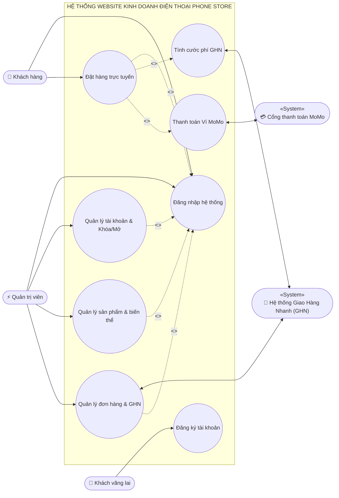

---

### Biểu đồ Use Case phân rã và tài liệu luồng sự kiện:

Dựa trên các quan hệ trên biểu đồ Use Case được biểu diễn lại thành dạng phân cấp gọi là phân rã biểu đồ Use Case. Hệ thống Phone Store bao gồm **6 Use Case chính**:

---

#### 1. Use Case phân rã chức năng đăng ký:

##### **Hình 2.2. Biểu đồ Use Case phân rã chức năng đăng ký**

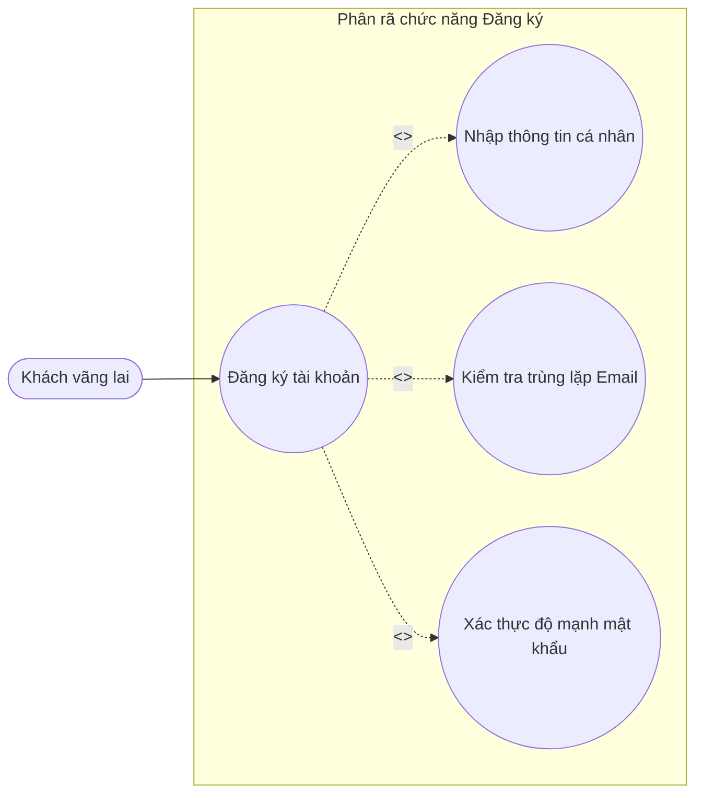

##### **Bảng 1: Kịch bản Use Case đăng ký**

| Mục | Nội dung chi tiết |
| :--- | :--- |
| **Tên Use Case** | Đăng ký |
| **Mô tả** | Khách hàng chưa có tài khoản, muốn tạo tài khoản mới để mua điện thoại và quản lý đơn hàng tại Phone Store. |
| **Tác nhân** | Khách vãng lai. |
| **Tiền điều kiện** | Tác nhân đang ở giao diện trang web Phone Store. |
| **Đảm bảo tối thiểu** | Hệ thống giữ nguyên thông tin đã nhập trên form kèm thông báo lỗi cụ thể, không làm mất dữ liệu. |
| **Đảm bảo thành công** | Tạo tài khoản khách hàng mới thành công, lưu thông tin vào cơ sở dữ liệu và chuyển đến trang đăng nhập. |
| **Kích hoạt** | Tác nhân chọn chức năng “Đăng ký” trên thanh điều hướng. |
| **Chuỗi sự kiện chính** | 1. Tác nhân chọn chức năng “Đăng ký”. 2. Hệ thống hiển thị biểu mẫu đăng ký tài khoản (Họ tên, Email, Số điện thoại, Mật khẩu, Xác nhận mật khẩu). 3. Tác nhân nhập đầy đủ thông tin theo form đăng ký và ấn nút “Đăng ký”. 4. Hệ thống kiểm tra tính hợp lệ của dữ liệu, băm mật khẩu bảo mật (Bcrypt) và lưu tài khoản vào CSDL. 5. Hệ thống thông báo “Đăng ký tài khoản thành công” và tự động chuyển đến màn hình đăng nhập. |
| **Ngoại lệ** | 3.1. Tác nhân bỏ trống các trường bắt buộc hoặc nhập sai định dạng email: Hệ thống đánh dấu đỏ và yêu cầu nhập lại đúng quy chuẩn. 3.2. Email hoặc số điện thoại đã tồn tại trên hệ thống: Hệ thống báo lỗi “Email này đã được sử dụng”. 3.3. Mật khẩu xác nhận không trùng khớp hoặc mật khẩu dưới 6 ký tự: Hệ thống thông báo lỗi mật khẩu. 3.4. Tác nhân nhập lại thông tin chính xác theo thông báo. |

---

#### 2. Use Case phân rã chức năng đăng nhập:

##### **Hình 2.3. Biểu đồ Use Case phân rã chức năng đăng nhập**

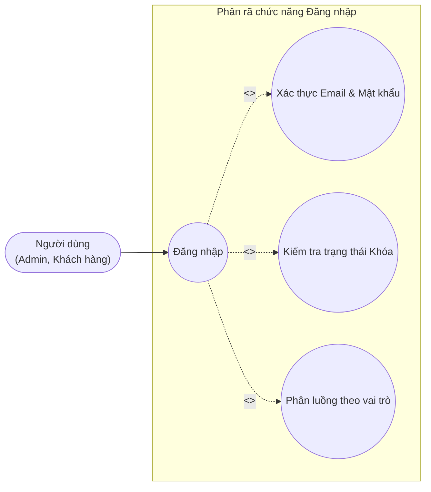

##### **Bảng 2: Kịch bản Use Case đăng nhập**

| Mục | Nội dung chi tiết |
| :--- | :--- |
| **Tên Use Case** | Đăng nhập |
| **Mô tả** | Người dùng (Khách hàng hoặc Quản trị viên) đăng nhập vào tài khoản của mình trên hệ thống Phone Store. |
| **Tác nhân** | Khách hàng, Quản trị viên (Admin). |
| **Tiền điều kiện** | Tác nhân đang ở giao diện trang web Phone Store và đã có tài khoản. |
| **Đảm bảo tối thiểu** | Hệ thống giữ nguyên giao diện đăng nhập và hiển thị thông báo lỗi nếu xác thực thất bại. |
| **Đảm bảo thành công** | Xác thực danh tính thành công, khởi tạo phiên làm việc và hiển thị giao diện tương ứng theo vai trò. |
| **Kích hoạt** | Tác nhân chọn chức năng “Đăng nhập”. |
| **Chuỗi sự kiện chính** | 1. Tác nhân chọn chức năng “Đăng nhập”. 2. Hệ thống hiển thị biểu mẫu đăng nhập (Email và Mật khẩu). 3. Tác nhân nhập địa chỉ email, mật khẩu và ấn nút “Đăng nhập”. 4. Hệ thống kiểm tra dữ liệu xác thực trong cơ sở dữ liệu. 5. Hệ thống kiểm tra trạng thái tài khoản: Tài khoản đang hoạt động bình thường (`is_locked = 0`). 6. Hệ thống phân luồng giao diện: &nbsp;&nbsp;&nbsp;&nbsp;- Nếu là Quản trị viên (Admin): Chuyển hướng vào trang Bảng điều khiển quản trị Dashboard. &nbsp;&nbsp;&nbsp;&nbsp;- Nếu là Khách hàng: Chuyển hướng về trang chủ mua sắm hoặc trang giỏ hàng. |
| **Ngoại lệ** | 4.1. Tác nhân nhập sai email hoặc mật khẩu: Hệ thống thông báo “Email hoặc mật khẩu không chính xác”. 5.1. Tài khoản đang trong trạng thái bị khóa (`is_locked = 1`): Hệ thống từ chối đăng nhập, hủy phiên và hiển thị cảnh báo: “Tài khoản của bạn đã bị khóa bởi Quản trị viên. Vui lòng liên hệ hỗ trợ”. 5.2. Tác nhân thực hiện nhập lại thông tin. |

---

#### 3. Use Case phân rã chức năng quản lý tài khoản:

##### **Hình 2.4. Biểu đồ Use Case phân rã chức năng quản lý tài khoản**

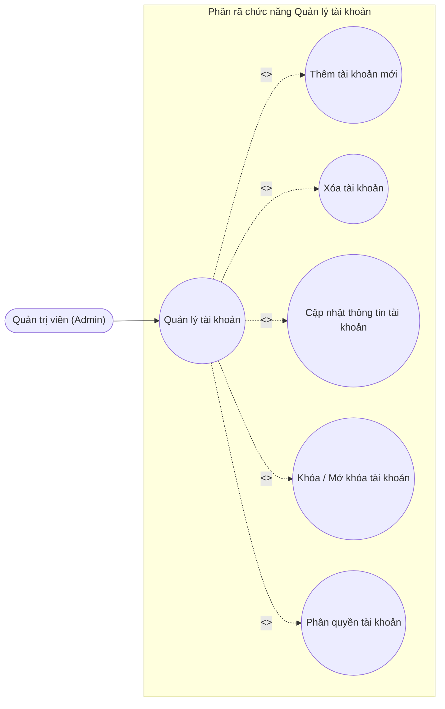

##### **Bảng 3: Kịch bản Use Case thêm tài khoản**

| Mục | Nội dung chi tiết |
| :--- | :--- |
| **Tên Use Case** | Thêm tài khoản |
| **Mô tả** | Admin có thể tạo tài khoản người dùng hoặc quản trị mới trực tiếp trên hệ thống Phone Store. |
| **Actor** | Quản trị viên (Admin). |
| **Tiền điều kiện** | Admin phải đăng nhập vào hệ thống quản trị. |
| **Đảm bảo tối thiểu** | Hệ thống giữ nguyên giao diện thêm tài khoản và không lưu dữ liệu nếu xảy ra lỗi. |
| **Đảm bảo thành công** | Tài khoản mới được thêm thành công vào cơ sở dữ liệu. |
| **Kích hoạt** | Admin chọn chức năng “Thêm người dùng mới” trong module Quản lý tài khoản. |
| **Chuỗi sự kiện chính** | 1. Admin chọn chức năng “Quản lý tài khoản”. 2. Hệ thống hiển thị danh sách tài khoản hiện có. 3. Admin chọn “Thêm Người Dùng Mới”. 4. Hệ thống hiển thị form thêm tài khoản (Họ tên, Email, Mật khẩu, Số điện thoại, Địa chỉ, Vai trò, Trạng thái ban đầu). 5. Admin nhập đầy đủ thông tin và chọn vai trò mong muốn. 6. Admin xác nhận nhấn “Lưu Người Dùng”. 7. Hệ thống mã hóa mật khẩu, lưu tài khoản vào CSDL và thông báo “Thêm người dùng mới thành công”. |
| **Ngoại lệ** | 5a. Admin hủy thao tác: Hệ thống quay lại danh sách tài khoản. 6a. Email đã được sử dụng: Hệ thống hiển thị thông báo lỗi “Email này đã được sử dụng bởi người dùng khác”. |

##### **Bảng 4: Kịch bản Use Case xóa tài khoản**

| Mục | Nội dung chi tiết |
| :--- | :--- |
| **Tên Use Case** | Xóa tài khoản |
| **Mô tả** | Admin xóa tài khoản người dùng khỏi hệ thống Phone Store. |
| **Actor** | Quản trị viên (Admin). |
| **Tiền điều kiện** | Admin đã đăng nhập vào hệ thống quản trị. |
| **Đảm bảo tối thiểu** | Hệ thống quay lại giao diện danh sách tài khoản, giữ nguyên dữ liệu nếu quá trình xóa bị hủy. |
| **Đảm bảo thành công** | Tài khoản được xóa thành công khỏi CSDL. |
| **Kích hoạt** | Admin chọn nút “Xóa” tại tài khoản tương ứng trong danh sách. |
| **Chuỗi sự kiện chính** | 1. Admin chọn chức năng “Quản lý tài khoản”. 2. Hệ thống hiển thị bảng dữ liệu người dùng. 3. Admin chọn tài khoản cần xóa và nhấn nút “Xóa”. 4. Hệ thống hiển thị hộp thoại xác nhận: “Bạn có chắc chắn muốn xóa tài khoản này không?”. 5. Admin bấm “Xác nhận”. 6. Hệ thống thực hiện xóa tài khoản trong CSDL và thông báo “Đã xóa người dùng thành công”. |
| **Ngoại lệ** | 5a. Admin chọn xóa chính tài khoản mình đang đăng nhập: Hệ thống ngăn chặn và báo lỗi “Bạn không thể tự xóa tài khoản của chính mình”. 5b. Admin nhấn “Hủy bỏ”: Hệ thống giữ nguyên tài khoản. |

##### **Bảng 5: Kịch bản Use Case chỉnh sửa thông tin tài khoản**

| Mục | Nội dung chi tiết |
| :--- | :--- |
| **Tên Use Case** | Cập nhật thông tin tài khoản |
| **Mô tả** | Admin có thể sửa đổi thông tin cá nhân, vai trò hoặc mật khẩu của tài khoản người dùng. |
| **Actor** | Quản trị viên (Admin). |
| **Tiền điều kiện** | Admin đã đăng nhập vào hệ thống. |
| **Đảm bảo tối thiểu** | Hệ thống giữ nguyên thông tin cũ nếu thao tác cập nhật thất bại. |
| **Đảm bảo thành công** | Thông tin tài khoản được cập nhật chính xác vào CSDL. |
| **Kích hoạt** | Admin nhấn “Sửa” tại tài khoản cần chỉnh sửa trong danh sách. |
| **Chuỗi sự kiện chính** | 1. Admin chọn menu “Quản lý tài khoản”. 2. Hệ thống hiển thị danh sách tài khoản. 3. Admin chọn “Sửa” tại tài khoản mong muốn. 4. Hệ thống tải dữ liệu hiện tại lên biểu mẫu cập nhật. 5. Admin nhập các thông tin mới (Họ tên, Số điện thoại, Địa chỉ, Đổi mật khẩu nếu cần, Trạng thái khóa/mở) và nhấn “Lưu”. 6. Hệ thống kiểm tra dữ liệu và lưu vào cơ sở dữ liệu. 7. Hệ thống thông báo “Đã cập nhật thông tin người dùng thành công”. |
| **Ngoại lệ** | 5a. Nhập sai định dạng email hoặc số điện thoại: Hệ thống báo lỗi và giữ lại form. |

##### **Bảng 6: Kịch bản Use Case Khóa/Mở tài khoản**

| Mục | Nội dung chi tiết |
| :--- | :--- |
| **Tên Use Case** | Khóa/Mở khóa tài khoản |
| **Mô tả** | Admin có thể khóa hoặc mở khóa tài khoản khách hàng khi có vi phạm chính sách hoặc theo yêu cầu bảo mật. |
| **Actor** | Quản trị viên (Admin). |
| **Tiền điều kiện** | Admin đã đăng nhập vào hệ thống quản trị Phone Store. |
| **Đảm bảo tối thiểu** | Hệ thống giữ nguyên trạng thái tài khoản nếu thao tác bị lỗi. |
| **Đảm bảo thành công** | Trạng thái tài khoản (Hoạt động / Bị khóa) được cập nhật thành công và có hiệu lực ngay lập tức. |
| **Kích hoạt** | Admin nhấn nút thao tác “🔒 Khóa” hoặc “🔓 Mở khóa” tại dòng tài khoản trong danh sách. |
| **Chuỗi sự kiện chính** | 1. Admin chọn chức năng “Quản lý tài khoản”. 2. Hệ thống hiển thị danh sách tài khoản cùng cột trạng thái (🟢 Hoạt động / 🔒 Bị khóa). 3. Admin chọn tài khoản cần khóa hoặc mở khóa. 4. Hệ thống hiển thị thông báo xác nhận: “Bạn có chắc chắn muốn thay đổi trạng thái tài khoản này?”. 5. Admin bấm “Xác nhận”. 6. Hệ thống cập nhật trường trạng thái (`is_locked`) trong CSDL. 7. Hệ thống hiển thị thông báo thành công: “Đã khóa (hoặc mở khóa) tài khoản thành công”. |
| **Ngoại lệ** | 5a. Admin cố tình khóa tài khoản của chính mình hoặc tài khoản Super Admin: Hệ thống ngăn chặn và từ chối thao tác. 5b. Admin nhấn hủy xác nhận: Hệ thống đóng thông báo và giữ nguyên trạng thái tài khoản. |

##### **Bảng 7: Kịch bản Use Case phân quyền**

| Mục | Nội dung chi tiết |
| :--- | :--- |
| **Tên Use Case** | Phân quyền |
| **Mô tả** | Admin có thể phân quyền vai trò cho tài khoản (Quản trị viên hoặc Khách hàng thành viên). |
| **Actor** | Quản trị viên (Admin). |
| **Tiền điều kiện** | Admin đã đăng nhập vào hệ thống quản trị Phone Store. |
| **Đảm bảo tối thiểu** | Quyền tài khoản giữ nguyên nếu cập nhật thất bại. |
| **Đảm bảo thành công** | Quyền hạn và vai trò của tài khoản được cập nhật chính xác trong CSDL. |
| **Kích hoạt** | Admin chọn chức năng phân quyền / sửa vai trò tại tài khoản mong muốn. |
| **Chuỗi sự kiện chính** | 1. Admin chọn chức năng “Quản lý tài khoản”. 2. Hệ thống hiển thị danh sách tài khoản. 3. Admin chọn “Sửa” tại tài khoản cần thiết lập quyền. 4. Hệ thống hiển thị mục chọn vai trò hệ thống: Quản trị viên (`admin`) hoặc Khách hàng (`user`). 5. Admin lựa chọn vai trò mới phù hợp và nhấn “Lưu”. 6. Hệ thống cập nhật trường `role` và `is_admin` trong CSDL. 7. Hệ thống thông báo “Phân quyền tài khoản thành công”. |
| **Ngoại lệ** | 5a. Admin hủy thao tác: Hệ thống không thay đổi vai trò hiện tại. |

---

#### 4. Use Case phân rã chức năng quản lý sản phẩm:

##### **Hình 2.5. Biểu đồ Use Case phân rã chức năng quản lý sản phẩm**

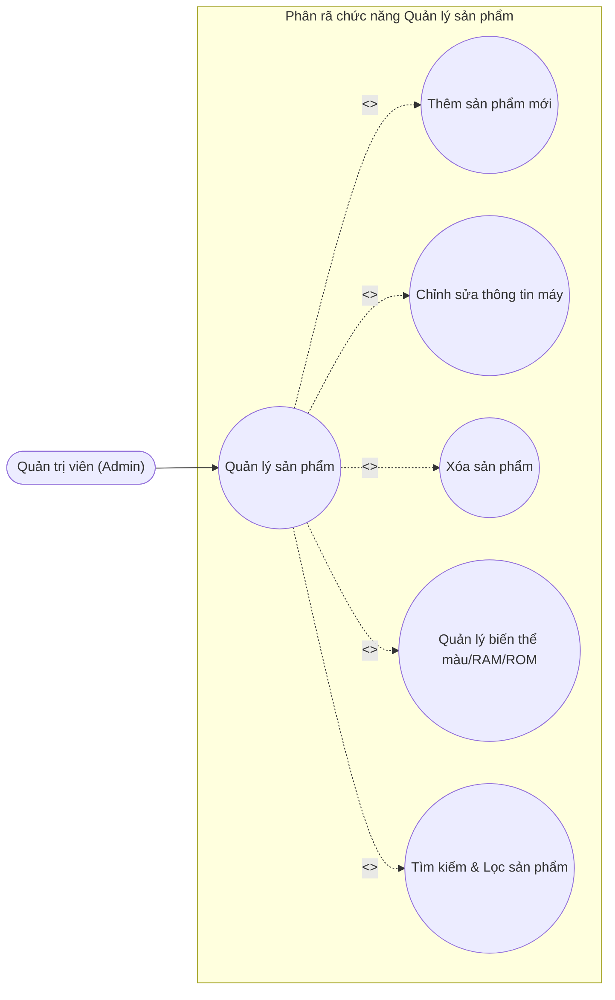

##### **Bảng 8: Kịch bản thêm sản phẩm**

| Mục | Nội dung chi tiết |
| :--- | :--- |
| **Tên Use Case** | Thêm sản phẩm |
| **Mô tả** | Quản trị viên thêm mới mẫu điện thoại thông minh cùng cấu hình phần cứng và các biến thể màu/bộ nhớ vào hệ thống Phone Store. |
| **Actor** | Quản trị viên (Admin). |
| **Tiền điều kiện** | Admin đã đăng nhập vào hệ thống quản trị. |
| **Đảm bảo tối thiểu** | Hệ thống giữ nguyên dữ liệu đang nhập trên form nếu xảy ra lỗi. |
| **Đảm bảo thành công** | Sản phẩm điện thoại mới được thêm thành công vào cơ sở dữ liệu và hiển thị trên website. |
| **Kích hoạt** | Admin nhấn nút “Thêm sản phẩm mới” trong module Quản lý sản phẩm. |
| **Chuỗi sự kiện chính** | 1. Admin chọn menu “Quản lý sản phẩm”. 2. Hệ thống hiển thị danh sách các sản phẩm hiện có. 3. Admin nhấn nút “Thêm sản phẩm”. 4. Hệ thống hiển thị form nhập thông tin (Tên điện thoại, hãng sản xuất, giá niêm yết, thông số kỹ thuật: CPU, RAM, ROM, pin, màn hình, camera; tải lên hình ảnh và danh sách biến thể màu sắc/dung lượng). 5. Admin nhập đầy đủ thông tin sản phẩm và nhấn nút “Lưu sản phẩm”. 6. Hệ thống kiểm tra tính hợp lệ của dữ liệu, lưu sản phẩm vào CSDL. 7. Hệ thống thông báo “Thêm sản phẩm thành công” và quay về trang danh sách. |
| **Ngoại lệ** | 5.1. Bỏ trống các trường bắt buộc hoặc giá bán/số lượng nhập số âm: Hệ thống báo lỗi dữ liệu không hợp lệ. |

##### **Bảng 9: Kịch bản xóa sản phẩm**

| Mục | Nội dung chi tiết |
| :--- | :--- |
| **Tên Use Case** | Xóa sản phẩm |
| **Mô tả** | Admin có thể xóa sản phẩm điện thoại khỏi danh mục kinh doanh của cửa hàng. |
| **Actor** | Quản trị viên (Admin). |
| **Tiền điều kiện** | Admin đã đăng nhập và đang ở trang quản lý sản phẩm. |
| **Đảm bảo tối thiểu** | Sản phẩm không bị xóa nếu Admin hủy thao tác xác nhận. |
| **Đảm bảo thành công** | Sản phẩm được xóa khỏi danh sách bán hàng. |
| **Kích hoạt** | Admin nhấn biểu tượng “Xóa” tại dòng sản phẩm cần xóa. |
| **Chuỗi sự kiện chính** | 1. Admin chọn chức năng “Quản lý sản phẩm”. 2. Hệ thống hiển thị danh sách sản phẩm. 3. Admin tìm sản phẩm cần xóa và nhấn nút “Xóa”. 4. Hệ thống hiển thị hộp thoại xác nhận: “Bạn có chắc chắn muốn xóa sản phẩm này không?”. 5. Admin chọn “Xác nhận”. 6. Hệ thống thực hiện xóa sản phẩm trong CSDL. 7. Hệ thống thông báo “Xóa sản phẩm thành công” và cập nhật lại danh sách. |
| **Ngoại lệ** | 4.1. Admin chọn “Hủy bỏ”: Hệ thống đóng hộp thoại xác nhận, dữ liệu giữ nguyên. |

##### **Bảng 10: Kịch bản chỉnh sửa thông tin sản phẩm**

| Mục | Nội dung chi tiết |
| :--- | :--- |
| **Tên Use Case** | Chỉnh sửa thông tin sản phẩm |
| **Mô tả** | Admin cập nhật thông tin chi tiết, giá bán, cấu hình kỹ thuật hoặc cập nhật số lượng tồn kho theo phiên bản của điện thoại. |
| **Actor** | Quản trị viên (Admin). |
| **Tiền điều kiện** | Admin đã đăng nhập vào hệ thống quản trị. |
| **Đảm bảo tối thiểu** | Dữ liệu cũ của sản phẩm được giữ nguyên nếu quá trình cập nhật bị lỗi. |
| **Đảm bảo thành công** | Thông tin chỉnh sửa được cập nhật thành công vào cơ sở dữ liệu. |
| **Kích hoạt** | Admin nhấn nút “Sửa” tại sản phẩm tương ứng trong danh sách. |
| **Chuỗi sự kiện chính** | 1. Admin vào danh mục “Quản lý sản phẩm”. 2. Hệ thống hiển thị danh sách các điện thoại đang kinh doanh. 3. Admin nhấn nút “Chỉnh sửa” tại sản phẩm cần thay đổi. 4. Hệ thống tải toàn bộ dữ liệu hiện tại lên biểu mẫu cập nhật. 5. Admin chỉnh sửa các thông tin cần thiết và nhấn “Lưu”. 6. Hệ thống kiểm tra dữ liệu và ghi nhận thay đổi vào CSDL. 7. Hệ thống thông báo “Cập nhật thông tin sản phẩm thành công”. |
| **Ngoại lệ** | 5.1. Admin bấm hủy thao tác: Hệ thống quay lại trang danh sách và giữ nguyên dữ liệu ban đầu. |

---

#### 5. Use Case phân rã chức năng quản lý đơn hàng:

##### **Hình 2.6. Biểu đồ Use Case phân rã chức năng quản lý đơn hàng (Liên kết GHN)**

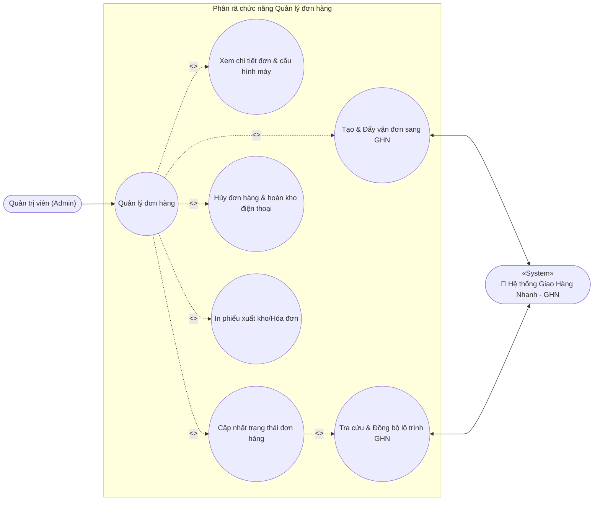

##### **Bảng 11: Kịch bản Use Case Quản lý đơn hàng & Điều phối vận chuyển GHN**

| Mục | Nội dung chi tiết |
| :--- | :--- |
| **Tên Use Case** | Quản lý đơn hàng & Điều phối vận chuyển GHN |
| **Mô tả** | Quản trị viên (Admin) xem chi tiết đơn hàng mua điện thoại, kiểm tra số lượng tồn kho theo phiên bản, xác nhận đơn hàng, gửi yêu cầu tạo vận đơn sang hệ thống Giao Hàng Nhanh (GHN Express) để bưu tá đến lấy hàng, in phiếu giao hàng và theo dõi lộ trình vận chuyển. |
| **Tác nhân chính (Actor)** | Quản trị viên (Admin). |
| **Tác nhân phụ (Secondary Actor)** | Hệ thống Giao Hàng Nhanh (GHN Express API). |
| **Tiền điều kiện** | Admin đã đăng nhập thành công vào hệ thống quản trị Phone Store và có ít nhất một đơn hàng đã được khách đặt trong hệ thống. |
| **Đảm bảo tối thiểu** | Trạng thái đơn hàng và dữ liệu tồn kho điện thoại không bị thay đổi nếu quá trình xử lý hoặc kết nối API GHN bị lỗi. |
| **Đảm bảo thành công** | Đơn hàng được cập nhật trạng thái xử lý, tạo thành công mã vận đơn GHN lưu vào cơ sở dữ liệu, đồng bộ hành trình giao hàng để khách hàng và admin cùng theo dõi. |
| **Kích hoạt** | Admin nhấn chọn chức năng “Quản lý đơn hàng” trên thanh điều hướng quản trị. |
| **Chuỗi sự kiện chính** | **1.** Admin chọn menu “Quản lý đơn hàng”. **2.** Hệ thống hiển thị bảng danh sách các đơn hàng (Mã đơn, Tên khách hàng, Tổng tiền, Hình thức thanh toán: COD hoặc MoMo, Ngày đặt, Trạng thái đơn). **3.** Admin nhấn chọn một đơn hàng cụ thể để xem chi tiết. **4.** Hệ thống hiển thị toàn bộ thông tin chi tiết: Mẫu điện thoại, màu sắc, dung lượng RAM/ROM, số lượng máy, tiền hàng, tiền ship, địa chỉ giao hàng và trạng thái thanh toán. **5.** Admin kiểm tra thông tin và nhấn chọn “Xác nhận đơn hàng”. **6.** Admin nhấn nút “Tạo & Đẩy vận đơn sang GHN”. **7.** Hệ thống Phone Store đóng gói dữ liệu đơn hàng (trọng lượng máy, kích thước hộp, địa chỉ kho gửi, địa chỉ nhận hàng, số tiền thu hộ COD nếu có) và gửi yêu cầu tạo đơn sang API GHN Express qua giao thức HTTPS có xác thực Token. **8.** Hệ thống GHN tiếp nhận yêu cầu, xử lý và phản hồi về mã vận đơn (Tracking Code) cùng ngày dự kiến giao hàng. **9.** Hệ thống Phone Store tự động lưu mã vận đơn GHN vào CSDL, cập nhật trạng thái đơn thành “Đang giao hàng” và hiển thị thông báo “Tạo vận đơn GHN thành công”. **10.** Admin có thể chọn in phiếu xuất kho / hóa đơn bán hàng đính kèm mã vạch vận đơn GHN để dán lên kiện hàng điện thoại. |
| **Ngoại lệ** | **3a.** Đơn hàng không tồn tại hoặc đã bị xóa: Hệ thống hiển thị cảnh báo lỗi và tải lại danh sách. **5a.** Điện thoại trong đơn không đủ số lượng tồn kho thực tế: Hệ thống cảnh báo thiếu hàng và từ chối duyệt đơn. **7a. Lỗi kết nối API Giao Hàng Nhanh:** Hệ thống ghi nhận nhật ký lỗi, hiển thị thông báo: *“Không thể kết nối đến hệ thống GHN, vui lòng kiểm tra lại cấu hình hoặc thử lại sau”*, trạng thái đơn hàng được giữ nguyên. **9a. Admin thao tác “Hủy đơn hàng”:** Hệ thống gửi yêu cầu hủy vận đơn sang GHN (nếu đã tạo), tự động kích hoạt tiến trình hoàn trả lại số lượng điện thoại vào kho tồn và cập nhật trạng thái đơn thành “Đã hủy”. |

---

#### 6. Use Case phân rã chức năng đặt hàng:

##### **Hình 2.7. Biểu đồ Use Case phân rã chức năng đặt hàng (Liên kết GHN và MoMo)**

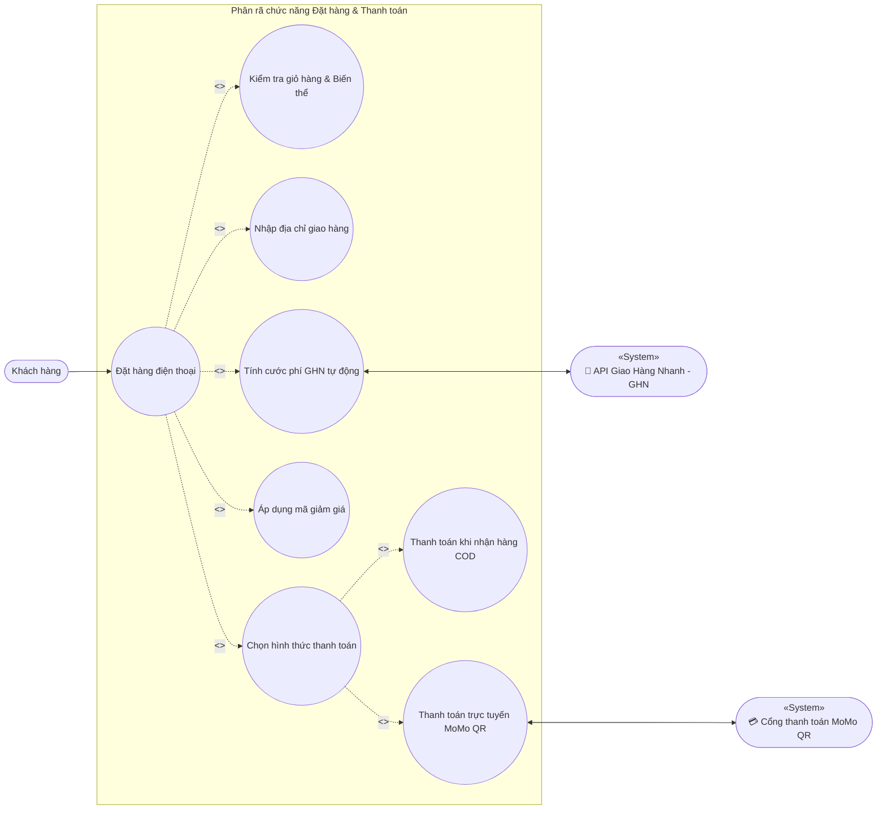

##### **Bảng 12: Kịch bản Use Case Đặt hàng & Thanh toán trực tuyến (Tích hợp GHN và MoMo)**

| Mục | Nội dung chi tiết |
| :--- | :--- |
| **Tên Use Case** | Đặt hàng & Thanh toán trực tuyến |
| **Mô tả** | Khách hàng tiến hành đặt mua các dòng điện thoại từ giỏ hàng, chọn địa chỉ nhận hàng, hệ thống tự động tính cước vận chuyển thời gian thực qua GHN, áp dụng mã giảm giá và lựa chọn phương thức thanh toán (Thanh toán khi nhận hàng COD hoặc Quét mã QR qua Ví MoMo). |
| **Tác nhân chính (Actor)** | Khách hàng (Customer). |
| **Tác nhân phụ (Secondary Actor)** | Hệ thống Giao Hàng Nhanh (GHN Express API), Cổng thanh toán Ví MoMo (MoMo Payment Gateway). |
| **Tiền điều kiện** | Khách hàng đã đăng nhập tài khoản vào website Phone Store và trong giỏ hàng có ít nhất một sản phẩm điện thoại còn hàng trong kho. |
| **Đảm bảo tối thiểu** | Hệ thống không tạo đơn hàng nếu người dùng hủy giao dịch hoặc quá trình thanh toán MoMo thất bại; giỏ hàng giữ nguyên vẹn. |
| **Đảm bảo thành công** | Đơn hàng được tạo thành công với đầy đủ mã đơn, cước phí GHN, phương thức thanh toán, số lượng máy được trừ tương ứng trong kho và khách hàng nhận được thông báo đặt hàng thành công. |
| **Kích hoạt** | Khách hàng nhấn nút “Tiến hành đặt hàng” hoặc “Thanh toán” trong trang giỏ hàng Phone Store. |
| **Chuỗi sự kiện chính** | **1.** Khách hàng mở giỏ hàng và kiểm tra các mẫu máy đã chọn (màu sắc, RAM/ROM, số lượng). **2.** Khách hàng nhấn nút “Tiến hành đặt hàng”. **3.** Khách hàng chọn hoặc nhập địa chỉ giao hàng (Tỉnh/Thành phố, Quận/Huyện, Phường/Xã, Địa chỉ cụ thể). **4. Tích hợp GHN:** Hệ thống tự động gửi mã định danh quận/huyện và phường/xã sang API GHN Express để tính cước phí vận chuyển chính xác theo thời gian thực và cập nhật ngay vào tổng tiền đơn hàng. **5.** Khách hàng nhập mã giảm giá (nếu có) và nhấn áp dụng để được chiết khấu giá trị đơn. **6. Lựa chọn phương thức thanh toán:** &nbsp;&nbsp;&nbsp;&nbsp;**• Nhánh A - Thanh toán khi nhận hàng (COD):** &nbsp;&nbsp;&nbsp;&nbsp;&nbsp;&nbsp;&nbsp;&nbsp;6.1a. Khách hàng chọn “Thanh toán tiền mặt khi nhận hàng (COD)”. &nbsp;&nbsp;&nbsp;&nbsp;&nbsp;&nbsp;&nbsp;&nbsp;6.2a. Khách hàng nhấn “Xác nhận đặt hàng”. &nbsp;&nbsp;&nbsp;&nbsp;&nbsp;&nbsp;&nbsp;&nbsp;6.3a. Hệ thống lưu đơn hàng vào CSDL với trạng thái “Chờ xác nhận”, phương thức thanh toán là COD. &nbsp;&nbsp;&nbsp;&nbsp;**• Nhánh B - Thanh toán trực tuyến qua Ví MoMo:** &nbsp;&nbsp;&nbsp;&nbsp;&nbsp;&nbsp;&nbsp;&nbsp;6.1b. Khách hàng chọn “Thanh toán trực tuyến qua Ví MoMo”. &nbsp;&nbsp;&nbsp;&nbsp;&nbsp;&nbsp;&nbsp;&nbsp;6.2b. Khách hàng nhấn “Xác nhận thanh toán”. &nbsp;&nbsp;&nbsp;&nbsp;&nbsp;&nbsp;&nbsp;&nbsp;6.3b. Hệ thống Phone Store mã hóa dữ liệu đơn hàng (tạo chữ ký bảo mật HMAC-SHA256 với SecretKey) và gửi yêu cầu khởi tạo giao dịch sang API Cổng thanh toán MoMo. &nbsp;&nbsp;&nbsp;&nbsp;&nbsp;&nbsp;&nbsp;&nbsp;6.4b. MoMo tiếp nhận và trả về URL thanh toán; hệ thống tự động chuyển hướng khách hàng sang cổng MoMo hiển thị mã QR thanh toán. &nbsp;&nbsp;&nbsp;&nbsp;&nbsp;&nbsp;&nbsp;&nbsp;6.5b. Khách hàng mở ứng dụng MoMo trên điện thoại và thực hiện quét mã QR để xác nhận thanh toán. &nbsp;&nbsp;&nbsp;&nbsp;&nbsp;&nbsp;&nbsp;&nbsp;6.6b. Cổng thanh toán MoMo trừ tiền ví của khách và gửi thông báo xác nhận giao dịch thành công (IPN / Webhook) về máy chủ Phone Store. &nbsp;&nbsp;&nbsp;&nbsp;&nbsp;&nbsp;&nbsp;&nbsp;6.7b. Hệ thống Phone Store xác thực chữ ký phản hồi của MoMo, lưu mã giao dịch MoMo và cập nhật đơn hàng thành “Đã thanh toán qua MoMo”. **7.** Hệ thống tự động trừ số lượng tồn kho của từng phiên bản điện thoại theo đúng số lượng đặt mua trong Database Transaction nguyên tử (ACID). **8.** Hệ thống làm rỗng giỏ hàng của khách và chuyển hướng đến trang “Đặt hàng thành công” kèm mã tra cứu đơn hàng. |
| **Ngoại lệ** | **2a.** Giỏ hàng trống hoặc có sản phẩm điện thoại vừa hết hàng trong kho: Hệ thống báo lỗi và yêu cầu cập nhật lại giỏ hàng. **3a.** Khách hàng để trống thông tin người nhận hoặc địa chỉ: Hệ thống hiển thị cảnh báo đỏ yêu cầu nhập đầy đủ. **4a. Lỗi kết nối API Giao Hàng Nhanh:** Hệ thống áp dụng mức cước vận chuyển dự phòng mặc định (ví dụ 30.000 VNĐ) và hiển thị thông báo cho khách hàng. **6b.1. Khách hàng hủy thanh toán trên cổng MoMo hoặc hết hạn thời gian quét mã QR:** MoMo thông báo giao dịch thất bại và chuyển hướng khách về lại Phone Store; hệ thống hiển thị thông báo: *“Giao dịch MoMo chưa hoàn tất. Vui lòng thanh toán lại hoặc chọn phương thức COD”*, tài khoản của khách không bị trừ tiền và giỏ hàng được giữ nguyên. |

---

## 2.2.2. Sơ đồ tuần tự

Sơ đồ tuần tự (Sequence Diagram) là một trong những loại sơ đồ tương tác quan trọng nhất của UML, được sử dụng để mô tả cách các đối tượng trong hệ thống tương tác với nhau theo trình tự thời gian. Mục tiêu chính của sơ đồ này là minh họa quá trình thực hiện một chức năng cụ thể thông qua việc các đối tượng gửi và nhận thông điệp lẫn nhau. Nói cách khác, sơ đồ tuần tự trả lời cho câu hỏi: *“Những đối tượng nào tham gia vào một chức năng, chúng giao tiếp với nhau như thế nào và theo thứ tự ra sao?”*

Hệ thống có **6 sơ đồ tuần tự** tương ứng chuẩn 1:1 với **6 Use Case chính** ở trên. Đối với các chức năng yêu cầu phân quyền, sơ đồ tuần tự mô tả quy trình người dùng đi qua **Giao diện đăng nhập** trước để xác thực, sau đó hệ thống mới chuyển hướng tới **Giao diện chức năng** tương ứng.

---

### **Hình 2.8. Sơ đồ tuần tự chức năng đăng ký tài khoản**

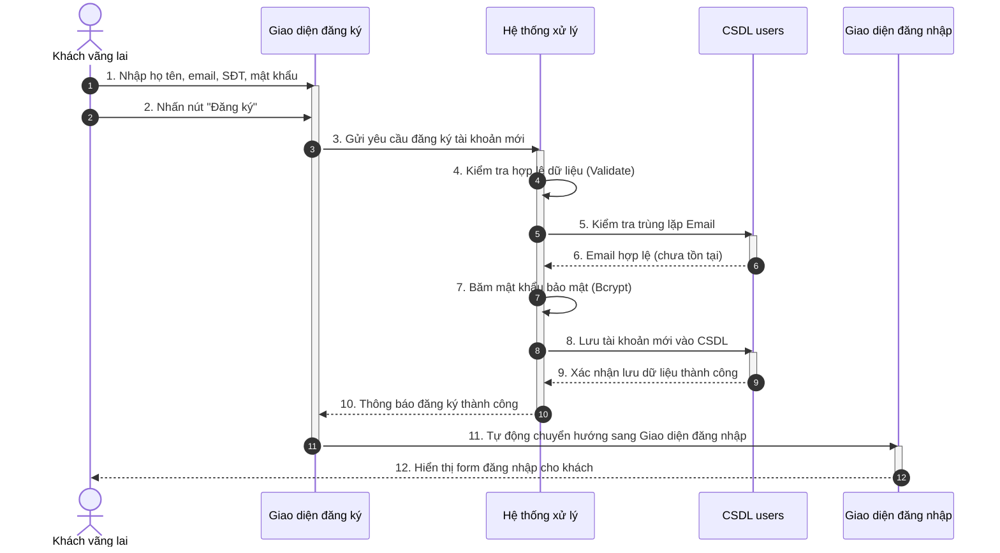

---

### **Hình 2.9. Sơ đồ tuần tự chức năng đăng nhập**

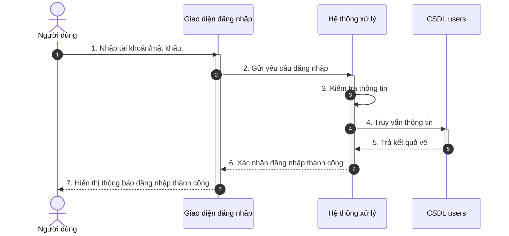

---

### **Hình 2.10. Sơ đồ tuần tự chức năng quản lý tài khoản (Khóa/Mở tài khoản)**

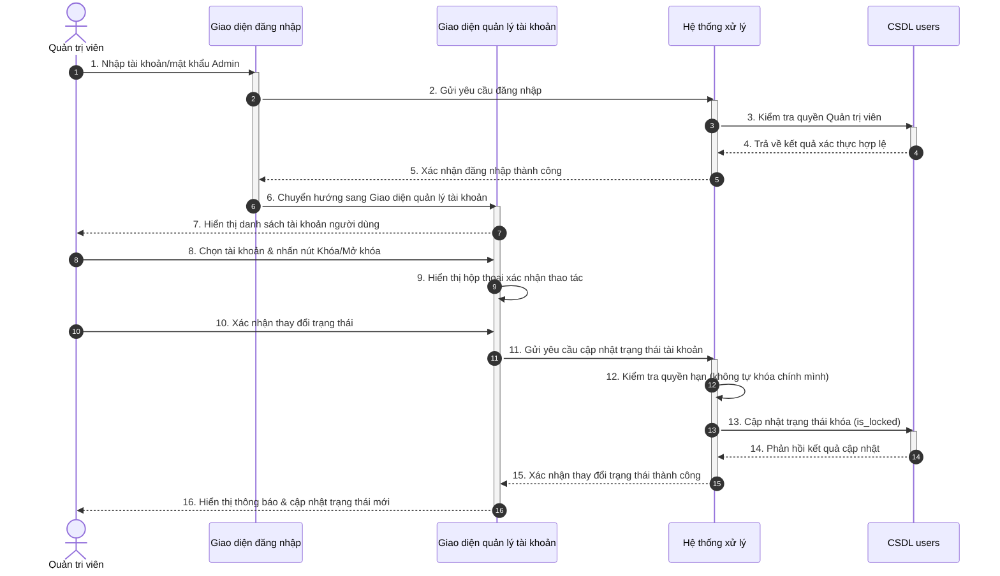

---

### **Hình 2.11. Sơ đồ tuần tự chức năng quản lý sản phẩm (Thêm điện thoại mới)**

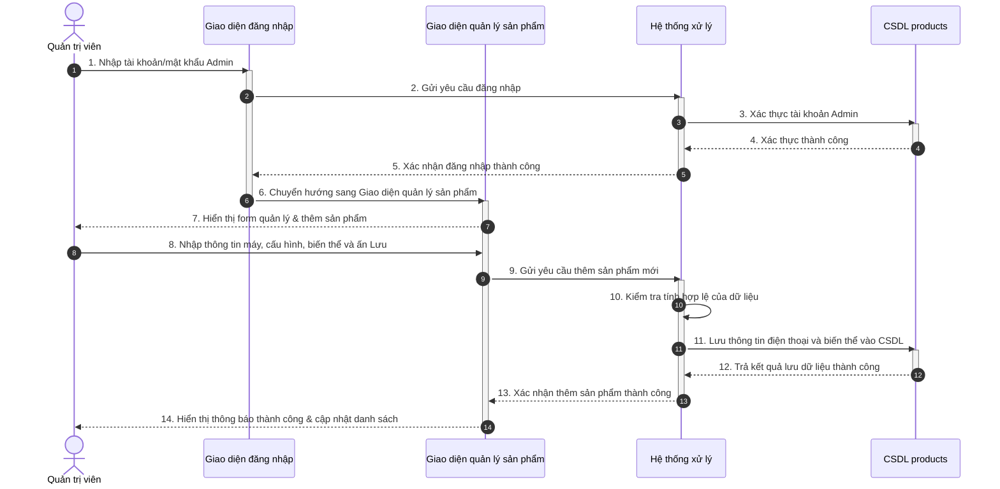

---

### **Hình 2.12. Sơ đồ tuần tự chức năng quản lý đơn hàng & đẩy vận đơn GHN**

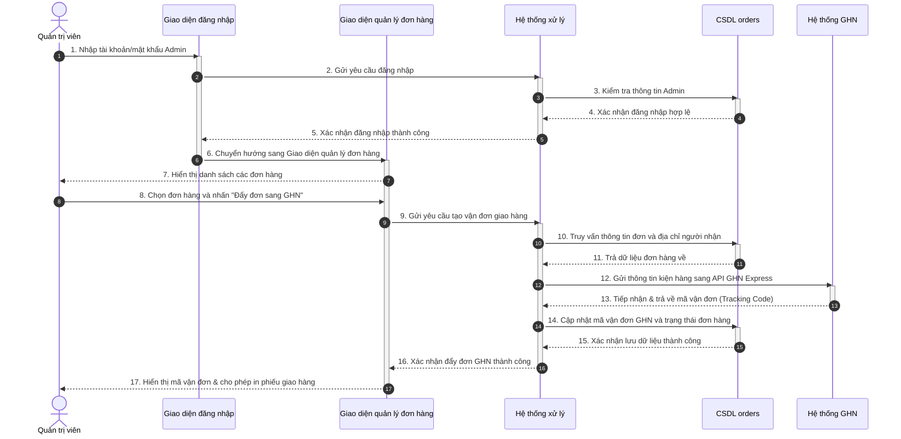

---

### **Hình 2.13. Sơ đồ tuần tự chức năng đặt hàng & thanh toán (MoMo & GHN)**

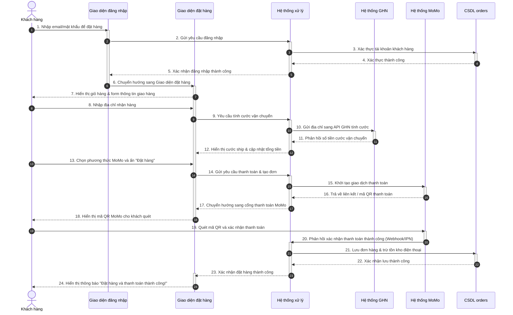
